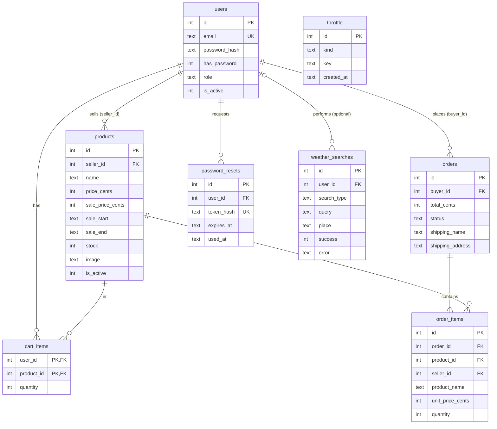

# LumaMarket

A Flask + SQLite marketplace for a university project, covering authentication (Stage 1), e-commerce (Stage 2) and weather plus administration (Stage 3). No frameworks beyond Flask; the code uses short helper functions and direct SQLite so it is easy to follow.

## Setup

```bash
python3 -m venv .venv && source .venv/bin/activate
pip install -r requirements.txt
cp .env.example .env          # then fill in the values (see below)
ADMIN_EMAIL='you@example.com' ADMIN_NAME='Your Name' ADMIN_PASSWORD='A-strong-pass1' python3 setup_admin.py
flask --app app run --debug   # http://127.0.0.1:5000
```

The database (`EcommerceDB`) is created or upgraded automatically on start. The upgrade only **adds** tables and one column; existing users are kept. Never commit `.env` or the database.

## Environment variables

| Variable | Needed for | Notes |
|---|---|---|
| `SECRET_KEY` | everything | Without it a random key is used and sessions end on every restart. |
| `ECOMMERCE_DATABASE` | optional | Path of the SQLite file. |
| `SESSION_COOKIE_SECURE` | production | Set to `1` only over HTTPS. |
| `APP_BASE_URL` | reset emails | e.g. `http://127.0.0.1:5000`; used to build the reset link. |
| `RESEND_API_KEY`, `RESEND_FROM_EMAIL` | reset emails | See Resend below. |
| `OPENWEATHER_API_KEY` | weather | See OpenWeather below. |
| `GOOGLE_CLIENT_ID`, `GOOGLE_CLIENT_SECRET`, `GOOGLE_REDIRECT_URI` | Google sign-in | Button is hidden when empty. |
| `CURRENCY`, `UPLOAD_DIR` | optional | Currency symbol (default `$`) and image folder. |

### Resend (password reset emails)
1. Create an account at resend.com, then **API Keys → Create API Key**; put it in `RESEND_API_KEY`.
2. For testing set `RESEND_FROM_EMAIL=LumaMarket <onboarding@resend.dev>`. In this sandbox Resend only delivers to the email address of your own Resend account. To email anyone, verify a domain under **Domains** and use an address on it.
3. With `FLASK_DEBUG=1`, if sending fails the reset link is also printed in the terminal (development only).

### OpenWeather
Create an account at openweathermap.org, copy the key from **API keys** into `OPENWEATHER_API_KEY`. New keys can take up to a couple of hours to activate (until then the page shows a "service could not answer" message). The app uses the free *Current weather data* endpoint.

### Google OAuth
1. [Google Cloud Console](https://console.cloud.google.com/) → **APIs & Services → OAuth consent screen** (External; add yourself as a test user).
2. **Credentials → Create credentials → OAuth client ID → Web application**.
3. Authorized redirect URI (exactly): `http://127.0.0.1:5000/auth/google/callback`.
4. Put the client id and secret in `.env` and open the app at `http://127.0.0.1:5000`.

New Google users choose Buyer or Seller (never Admin). They have no password (`has_password = 0`); they can set one on **Profile → Set a password** or through **Forgot password**.

## Features and routes

| Area | Routes | Who |
|---|---|---|
| Auth | `/register`, `/login`, `POST /logout`, `/forgot-password`, `/reset-password/<token>`, `/auth/google…` | public |
| Profile | `/profile`, `POST /profile/password` | signed in |
| Catalogue | `/products`, `/products/<id>`, `/uploads/products/<file>` | public |
| Seller | `/seller/dashboard`, `/seller/products/new`, `/seller/products/<id>/edit`, `POST …/status` | Seller (own products only) |
| Buyer | `/cart`, `POST /cart/add`, `/cart/update/<id>`, `/cart/remove/<id>`, `/checkout`, `/orders`, `/orders/<id>` | Buyer |
| Weather | `/weather` | public |
| Admin | `/admin/dashboard`, `POST /admin/users/<id>`, `POST /admin/admins`, `/admin/weather` | Admin |

### Security measures
Hashed passwords (Werkzeug scrypt); CSRF token on every POST; server-side role checks on every protected route; reset tokens are random, stored only as SHA-256 hashes, expire after 30 minutes, are single use (claimed atomically) and a new request cancels older links; the forgot-password answer is identical whether or not the email exists; reset requests are limited to 3 per email and 10 per IP per hour, sign-in to 10 failures per 15 minutes; password rules (8–128 chars, a letter and a number); image uploads are checked by their real bytes (PNG/JPG/GIF/WebP, ≤ 2 MB) and saved under random names; SQL uses parameters only; foreign keys and CHECK constraints are on; no-store cache headers so Back never shows a signed-out dashboard.

### Pricing and promotions
Prices are whole cents. A product has a regular price and an optional sale price (must be lower) with optional start/end dates (inclusive). The sale applies only while valid and inside its dates; the discount percentage is `round((regular − sale) / regular × 100)` and is hidden if it would be under 1%. The cart, checkout and order totals are computed on the server from the database; orders store the price actually paid.

### Checkout and stock
Checkout is simulated (no card fields; a tick-box confirms that). It runs in one `BEGIN IMMEDIATE` transaction: each product's stock is reduced with `UPDATE … WHERE stock >= quantity`, so the last item cannot be sold twice; if any line fails the whole order is rolled back.

## Database (ER diagram)



## Tests

```bash
python3 -m unittest discover -s tests -t .
```
The tests run on a temporary database and a temporary upload folder (set in `tests/__init__.py`; `wipe_database` refuses to run on anything else), and call neither Resend nor OpenWeather (both are mocked). 63 tests currently pass. They cover: CSRF rejection; role redirects and unauthorized dashboard/admin/seller/cart/order access; login throttling; password rules; reset flow, expiry, reuse, hashing, throttling, no email enumeration, inactive accounts, Google-only accounts; Resend request format; product validation (bad prices/stock/dates/images), database constraints, cross-seller edit attempts; promotions and date windows; cart limits and persistence; checkout totals, stock, rollback, concurrent last-item purchase, no card fields; weather success/validation/not-found/network/API errors, history persistence, admin-only statistics, rate limit.

## Manual test plan / demonstration sequence
1. **Register** a Seller and a Buyer (`/register`); sign in, note the different dashboards; sign out and press Back (login page, not a dashboard).
2. **Unauthorized access**: signed out, open `/admin/dashboard` (redirect); as Buyer open `/seller/products/new` and `/admin/dashboard` (403).
3. **Forgot password**: `/forgot-password` with your Resend-account email → open the email link → set a new password → reuse the same link (rejected) → wait 30 minutes or edit `expires_at` to see expiry. Try an unknown email: same message.
4. **Seller**: add a product with an image, a sale price and dates; try price `0`, a `.txt` renamed to `.png`, and a sale price above the price (all rejected). Sign in as another Seller and open `/seller/products/<id>/edit` (403).
5. **Buyer**: browse and search, add to cart, try a quantity above stock (limited), change quantities, check out (tick the simulated-payment box), see the confirmation; confirm the stock fell and the Seller dashboard lists the sale.
6. **Weather** (no login): search `Kigali`, then coordinates `-1.9441`, `30.0619`; try an empty field, `Xyzzyq` (not found), and disconnect the network (error with retry).
7. **Admin**: open **Weather search history** for the searches and usage statistics; manage users on the dashboard.

## HCI design decisions
1. **Visible feedback for every action** – flash messages (errors announced with `role="alert"`), a loading message while weather loads, and a confirmation page after ordering (visibility of system status).
2. **Error prevention before correction** – number inputs with min/max, price patterns, quantity capped at stock, and a confirm dialog before an Admin changes a role or deactivates an account.
3. **Honest, plain error messages** – "We could not find that place" vs "We could not reach the weather service", each with a next step (recognise, diagnose, recover).
4. **Consistency and familiarity** – one header/nav on every page, the same card, table and form styles, a struck-through old price with a "-25%" badge as on common shops.
5. **Accessibility** – labels on all inputs, skip link, visible focus ring, colour never the only signal (stock and sale states also use text), semantic tables that stack on phones, `aria-live` regions.
6. **Safe simulation** – the checkout states clearly that no real payment is taken and asks for no card data, so users are not misled.
7. **Privacy-preserving wording** – "If an account exists, we sent a link" protects users from account probing.

## Known limitations
- No email verification at registration, so someone could pre-register another person's address; Google sign-in then matches by email. Not in the required scope.
- Sessions store only the user id, so changing a password does not sign out other devices.
- The Resend sandbox sender only delivers to your own Resend account address until a domain is verified.
- Accounts created with Google before this update are not flagged `has_password = 0`; they can still use **Forgot password** to set a password.
- Orders have a single status ("Confirmed"); no shipping workflow, refunds or seller order management beyond the sales list.
- Rate limits are keyed on the client IP as the server sees it; behind a proxy configure it to pass the real IP.
- Screenshots are not included: they need a browser session which was not run here.
